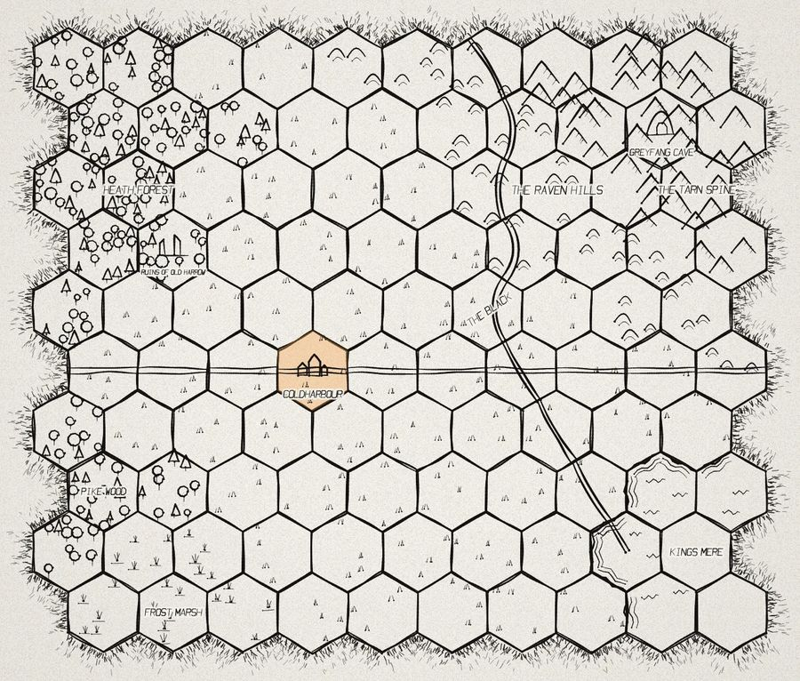
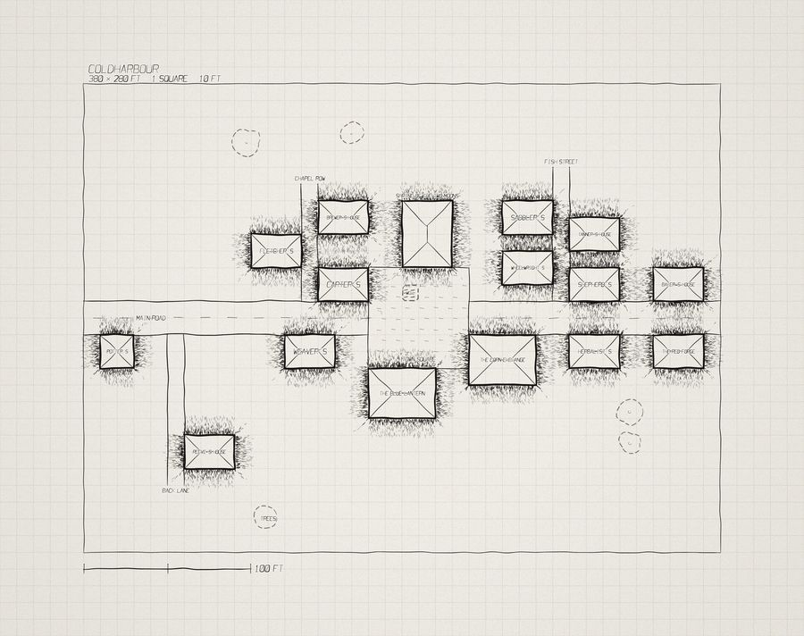
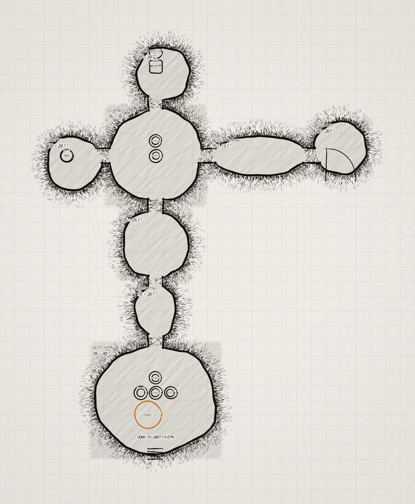
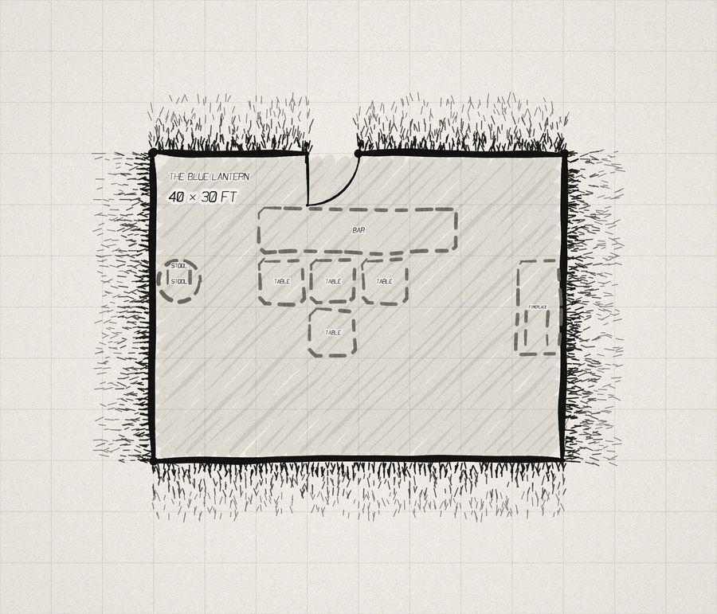

# Aether Observer for Foundry VTT

[](https://github.com/camererb/aether-observer-foundry/releases/latest)
[](LICENSE)


**Battle maps and hex maps in one click, and your session notes sent to a game log that remembers.**

The module connects Foundry to [Aether Observer](https://aetherobserver.com), a persistent world journal for tabletop games:
you record what happened, and the world remembers it. It has two parts, and you can use either one:

- **Vision**: maps made by voice or typing on [Vision](https://aetherobserver.com/aether-vision-maps) arrive in Foundry as
  scenes with the picture, grid and scale, walls, doors and torch lights. Hex area maps arrive as your players see them.
- **Session notes**: send a journal entry, a page, or a whole folder of them, to your Aether Observer game log as session
  notes, with the folder structure kept in the names.
- **"Last time" handout**: one button shows your players a recap of the last published session and the open quests.

<p align="center">
  
  
</p>
<p align="center">
  
  
</p>
<p align="center"><sub>Four of the eight free sample maps, as they arrive in Foundry.</sub></p>

## Try it free in a minute

No account and no link needed.

1. Install the module (below) and turn it on in your world.
2. Open the **Scenes** tab as the GM and press **Import sample maps**.
3. Eight ready-made scenes appear in a **Vision** folder, with walls, doors and lights already in place: a hex region (the
   Ashvale), a town (Coldharbour), an inn, two dungeons with a lower level each, and a river crossing.

## Install

**From Foundry (self-hosted or The Forge):** open **Install Module**, paste this into **Manifest URL**, and press **Install**:

```
https://github.com/camererb/aether-observer-foundry/releases/latest/download/module.json
```

Then, in your world: **Game Settings, Manage Modules**, tick **Aether Observer**, and save.

**By hand (self-hosted):** download `aether-observer.zip` from the [latest release](https://github.com/camererb/aether-observer-foundry/releases/latest),
unzip it into `Data/modules/aether-observer/` (so `module.json` sits directly inside that folder), restart Foundry, and turn
the module on as above.

Works with Foundry **v13** (written for it) and **v12**. This is a new module and has had little time in the wild: if
something doesn't work in your Foundry, please [open an issue](https://github.com/camererb/aether-observer-foundry/issues)
and say which Foundry version you use.

## Use your own maps and notes

Importing the sample maps is free. Bringing in **your own** maps and sending session notes needs an Aether Observer account on
a paid plan (see [aetherobserver.com/pricing](https://aetherobserver.com/pricing)). Vision itself is free to use on the website.

1. Press **Connect to Aether Observer** in the Scenes tab. A page opens on the site; sign in, check the code, and approve it.
2. Pick which TTRPG Log this Foundry world uses.
3. Maps you send from Vision arrive by themselves (or press **Sync from Vision**). Right-click a journal entry or folder and
   pick **Send to Aether Observer** to send notes.

More detail on each of these is further down.

## What it does and doesn't do

- It makes and updates **only its own** scenes, walls and lights. Anything you draw or place by hand is left alone.
- Your players never see the connection: it is kept in the GM's browser only.
- Notes go to your game log as **drafts**. Nothing becomes part of your world's history until you publish it on the site.
- It runs in the GM's browser and talks only to `aetherobserver.com`. See [SECURITY.md](SECURITY.md) for exactly what it
  sends and how to report a problem.

## Links

- Website: [aetherobserver.com](https://aetherobserver.com)
- Vision (the map maker): [aetherobserver.com/aether-vision-maps](https://aetherobserver.com/aether-vision-maps)
- Pricing: [aetherobserver.com/pricing](https://aetherobserver.com/pricing)
- Questions and bugs: [Issues](https://github.com/camererb/aether-observer-foundry/issues)
- Licence: [MIT](LICENSE). Free and open source.

---

# The details

## Import the sample maps (free, no account)

The module ships with eight ready-made scenes, so you can try it without an Aether Observer account or a link.

1. Install the module and turn it on in your world (Game Settings, Manage Modules, tick **Aether Observer**, save).
2. Open the **Scenes** tab (the map icon in the sidebar). As the GM you will see two buttons under *Create Scene*: **Sync
   from Vision** and **Import sample maps**.
3. Press **Import sample maps**. The scenes appear in the Scenes tab, in a **Vision** folder (the samples in a **Sample maps** folder inside it), and the first one (the hex region) opens. Maps you bring in from your own Vision link go in the **Vision** folder too.

The eight scenes: **The Ashvale** (a 10 by 10 hex region, with a town, a cave and some ruins on it), **Coldharbour** (the town),
**The Blue Lantern** (the inn), **Greyfang Cave** and **Ruins of Old Harrow** (and **Greyfang Cave: Below** and **Ruins of Old Harrow: Below**, their lower levels: Foundry has no levels in a scene, so each level is its own scene, and the stairs on the picture say where they go) and **Ambush at the Ford** (a river crossing).

Good to know:
- Importing takes a moment and about 16 MB of pictures are copied into your Foundry's data folder.
- It is safe to press again. A sample that is already there is skipped, so nothing doubles up, and your own changes to a
  scene (tokens, notes, hand-drawn walls) are left alone.
- The scenes are not added to the navigation bar at the top of the screen; open them from the Scenes tab.
- The folders are found by a hidden mark, so you can rename them or move a scene to another folder: a scene you have moved stays where you put it when it is updated. A scene made by an earlier version of the module is filed in the folder once.
- Delete a scene you do not want. It will not come back unless you press **Import sample maps** again.
- Only the GM sees the buttons.

## Sending maps from Vision

1. On Aether Observer, open the story's **Settings** (there is a link on the Vision tab and on Session notes), open **Foundry link** and press **Make a Foundry link**. Copy the
   link (it is only shown once; "Make a new link" replaces it and the old one stops working).
2. In Foundry: Game Settings, Configure Settings, **Aether Observer**, paste it into **Vision link**. It is
   kept on this computer only, so players never get it.
3. **Room maps:** on Vision, open the scene tab you want and pick **Map ▾, Send to Foundry**. Foundry brings it in
   within 5 seconds (or press **Sync from Vision** in the Scenes tab to do it at once and open the scene).
4. **Hex areas:** in the Hex areas tab, open **More** and tick **Keep Foundry up to date**, or press **Send to Foundry**.
   Only what your players see is sent: no hidden hexes, hidden things or encounters. While it is ticked, each change you
   make is sent a moment after you stop, and Foundry swaps the new picture in within 5 seconds. A change only you can see
   (a hidden thing, an encounter) sends nothing.

Each tab and each area gets its own Foundry scene, made the first time and updated after that. The automatic check only
updates scenes; it never opens one, so it can't pull you or your players away from the scene you are on. The button opens
the scene it brought in.

**Keep this Foundry window visible.** The check runs in the GM's browser, and a browser slows a hidden tab right down.
The setting **Check for new maps every 5 seconds** turns it off.

**A map stays in Foundry** until you delete the scene there (or turn on **Delete a scene when I remove its map** in the module's
settings, off by default: then pressing Remove on the site also deletes the scene this module made for it, and only that). On Aether Observer, the Foundry link panel lists every map
sent, each with a **Remove** button: that takes it off the list so it stops updating, and (unless you turned that setting on) leaves the scene in Foundry.
So players can always go back to an area you sent earlier.

Hex scenes are gridless (the picture has its own faint hex grid) and measured in miles: one hex across is one hex size
(1, 6 or 24 miles), so Foundry's ruler reads the distance across the map.

From a macro: `game.modules.get("aether-observer").api.sync()`.

## What it changes, and what it never touches

- A hex area has no walls, doors, lights or darkness at all. It makes and replaces only the walls and lights it made itself (they carry the module's flag). Walls you draw, your
  own lights, tokens, notes and drawings stay as they are.
- On a re-sync it updates the picture, the size and the grid. The scene's name, darkness, vision and fog are set only
  when the scene is first made, so your own changes stay.
- Every door arrives closed. Secret doors arrive as ordinary doors (change them to secret in Foundry if you want).
- Windows are solid walls. Furniture does not block sight.
- The picture (WebP, or JPEG) is saved into Foundry (`Data/aether-vision/`, or the Assets Library on The Forge), a new file for
  each update of a map. They add up on a long session (a hex picture is about 1 to 2 MB): delete the `aether-vision` folder
  now and then, from Foundry's file browser, when no scene needs it. If saving fails, the scene uses the picture straight from
  Aether Observer, which stops showing if you turn the link off.

## Updates keep what you did, and ignoring lighting (v0.2.1)

- **An update is a merge.** Walls and lights that haven't changed are left alone (a door you opened stays open); only new ones
  are added and gone ones removed. Your fog setting, tokens, notes, drawings and hand-drawn walls are kept. If the map grows
  to the north or west (the picture's corner moves), the tokens, notes, drawings, walls and lights already in the scene move
  with it. Foundry's explored-area record is not moved, so the newly shifted part may look unexplored. Not yet tried inside a
  real Foundry.
- **Live room maps:** on the Vision page, turn on **Keep Foundry up to date** in the Map menu and each change to the map
  is sent a few seconds after you make it; the module's automatic check (every 5 seconds) then brings it in.
- **Ignore lighting (global illumination)** (Configure Settings; off by default; room maps only): every update keeps global
  illumination on and darkness at 0, so torches and the dim ambient make no difference; walls still block sight.
- **Glowing mushrooms and crystals give light** (Configure Settings; on by default): in caves, mushrooms (soft green) and crystals
  (cold blue) on the map give a small, steady light of their own. Turn it off to leave them out. Cave systems now put
  crystals in the Crystal Grotto, the Deep Cavern and sometimes the Lair.

## Connect to Aether Observer (0.6.0, recommended)

Instead of pasting a link for each story, connect your account once:

1. In the **Scenes** tab press **Connect to Aether Observer**. A page on Aether Observer opens (the link and a code are
   also in a chat message only you can see).
2. Sign in, check the code matches, tick **Also let it send session notes** if you want that, and press **Approve**.
   Only approve a code you just started yourself.
3. Back in Foundry, pick which TTRPG Log this Foundry world uses. The button then reads **Aether Observer: <story>**;
   press it to pick another story or to disconnect this browser.

Maps and session notes then go through that story. See or remove your connections on Aether Observer at
`/foundry/connect` (Your Foundry connections); removing one stops it at once. The key is kept in your browser only.
A pasted Vision link still works when you are not connected.

## "Last time" handout (0.7.0)

Needs a connected account. In the **Journal** tab press **Show last time**: the module makes a journal entry
**Last time on <story>** from your story's latest published record (cut to a short recap) and its open quests, lets every
player read it, and shows it to them like a handout. Press it again after the next session and the same entry is updated.
Only what your players can already read on Aether Observer goes in it: published records, and quests the table has
confirmed and is still on.

## Session notes from Foundry journals

1. On Aether Observer, open the story's **Settings**, **Foundry link**, and tick **Also let Foundry send session notes**. The same Vision link
   is used; nothing new to paste.
2. In Foundry, right-click a journal entry and pick **Send to Aether Observer**, or press the same button at the top of an open entry.
   If the entry has several text pages, you are asked whether to send the whole entry, one page, or every page as its own notes.
   Right-click a journal folder and pick **Send folder to Aether Observer** to send every entry in it and its subfolders.
3. Each entry (or page) becomes one set of session notes on the story, named as in Foundry; a single page is named
   "Entry / Page". A folder keeps its structure in the names ("Season 2 / Session 12"). An entry sent whole gets a heading for
   each page. Text only: pictures are left out. Notes that came from Foundry show a **From Foundry** mark on the site.
4. Send again after you edit: the same notes are updated, not copied. Notes already published as a record, or open on the site
   right now, are left alone and Foundry tells you so.

From a macro: `game.modules.get("aether-observer").api.sendEntry(entry)`, `.sendPage(entry, page)` or `.sendFolder(folder)`.

## Files

- `module.json`: the manifest (minimum v12, verified v13).
- `scripts/aether-observer.js`: the buttons, settings, sync, connect and notes. Foundry-only code.
- `scripts/convert.js`: the map to Foundry walls, doors and lights. Plain code, tested with `node --test scripts/`.
- `scripts/notes.js` and `scripts/connect.js`: journal-to-notes conversion and the connect helpers, also plain, tested code.
- `lang/en.json`: the module's wording.
- `samples/`: the free sample maps (`index.json` lists them; each is a map file plus its picture).
- `images/`: the preview pictures on this page (not part of the installed module).

The map file Vision sends is a Universal VTT file (a picture, walls, doors and lights).

